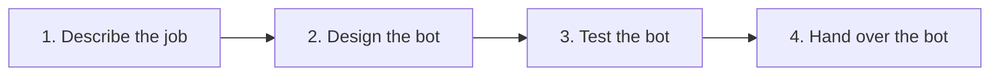

# Bots Factory

[Tiếng Việt](README.vi.md)

A production line for AI bots, like a software factory, but for small businesses. Describe the job, get a designed, tested, ready-to-use bot.

## What is this?

Picture a cake factory. It does not bake one cake by hand. It has a line: an order comes in, a recipe is chosen, a taster checks the cake, and a box goes out the door.

Bots Factory is the same line, but for **AI bots**. An AI bot is a helper you chat with that does one job for you.

Say you run an online shop. Customers ask the same questions all day: "Where is my order?", "Can I return this?". You want a helper that answers the way you would. That is the job we follow on this page.

1. **Describe the job.** You say what you need in plain words. *Cake factory: the customer's order.*
2. **Design the bot.** The factory plans who the bot is and what rules it follows. *The recipe.*
3. **Test the bot.** The bot is tried on made-up cases before it meets a real customer. *The taste test.*
4. **Hand over the bot.** You get a bot that is ready to use, with setup steps. *The box.*

## What you need

- A **brain**: Claude Code or Codex. These are AI programs that do the real work for you. You need an account with one of them.
- An **app window**: [Orca](https://github.com/stablyai/orca). This is the app where your bots live and where you chat with them.

## Part 1. Starter (install this first, it is required)

Starter is the basic crew of four bots. Every other pack needs it.

| Bot | What it does for you | In the cake factory |
|---|---|---|
| Ask Masonshare | Takes your request, picks the right bot, asks you before handing anything over, gives you one answer | The factory manager |
| Dried Plum | Plans a new bot: what it does, who it serves, what it may touch | The one who designs the recipe |
| Pink Pepper Coated Lotus Seeds | Writes the bot's "soul" (its standing rules and voice, read at the start of every chat) and its prompts (the messages you give an AI) | The one who writes the instructions on the card |
| Mango Spring Roll | Writes and tests "skills" (a skill is a how-to card for one job) | The one who writes the how-to cards |

The names are snacks. They only make the bots easy to remember.

Starter is solid but young: it does not have an automatic test set yet. The shop pack below does.

### Install in 3 steps

1. **Download.** Get this repository onto your computer (the green Code button on GitHub, then Download ZIP, or ask your brain to do it).
2. **Paste one sentence** into Claude Code or Codex and let it do the setup:

   > Please set up Bots Factory Starter for me. The repository is https://github.com/masonshare/bots-factory. Read docs/for-developers.md, section "Set the bots up in Orca", and create the four bots in packs/starter in Orca, each with its SOUL.md and its skills. Tell me when it is done and what I should do next.

3. **Open a NEW chat with each bot.** A chat that was already open does not load the soul and the skills. Starting a new chat is how a bot picks up its rules.

### Starter in action

You tell Ask Masonshare: "I need a helper that answers my customers."

- Ask Masonshare says which bot it would use and asks you: "Do you agree?" Nothing moves until you say yes.
- Dried Plum plans the helper. Pink Pepper writes its soul. Mango Spring Roll writes the how-to cards it needs.
- You get the pieces back in one answer.

Every bot asks you before it sends, shares, deletes or spends anything. Ask Masonshare never merges code changes for you.

## Part 2. More packs (each one needs Starter first)

A pack is a ready-made set of bots for one kind of job. Only packs that have been tested are listed here.

### Online shop: answering customers (`ecommerce-cskh`)

- **The problem:** you or your staff type the same answers all day, and they are not always the same answer.
- **What the bots do:** one bot helps you write answer scripts, which stay drafts until you approve them. Another helps your staff answer customers using only your approved scripts. It cannot change them.
- **Start here:** [`packs/ecommerce-cskh/README.md`](packs/ecommerce-cskh/README.md). Install Starter first. The pack is written for Vietnamese-speaking shops (Shopee, Zalo, hotline) and uses made-up sample data only.

## Words we used

- **Bot:** a helper that does one job.
- **Soul:** the bot's standing rules, read at the start of every chat. Like a job description pinned to the wall.
- **Skill:** a how-to card for one job.
- **Prompt:** a message you give an AI.
- **Pack:** a box of bots that belong together.
- **Brain:** Claude Code or Codex. **App window:** Orca.

## Need help?

Open an issue on [GitHub](https://github.com/masonshare/bots-factory/issues). Do not put real customer details in it.

## For developers

Install with npx, folder layout, tests and CI: [docs/for-developers.md](docs/for-developers.md). Credits: [CREDITS.md](CREDITS.md). MIT License: [LICENSE](LICENSE). Everything in this public repo is made-up example data.
