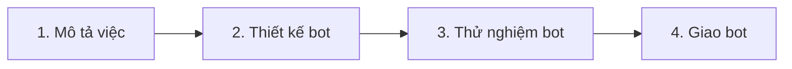

# Bots Factory

[English](README.md)

Dây chuyền sản xuất bot AI, giống một nhà máy phần mềm nhưng dành cho doanh nghiệp nhỏ. Bạn mô tả việc cần làm, nhận về một bot đã được thiết kế, thử nghiệm và dùng được ngay.

## Đây là gì?

Hãy nghĩ tới một nhà máy bánh. Nhà máy không nướng từng cái bánh bằng tay. Nó có một dây chuyền: nhận đơn, chọn công thức, có người nếm thử, rồi đóng hộp giao đi.

Bots Factory là dây chuyền như vậy, nhưng cho **bot AI**. Bot AI là một người giúp việc mà bạn trò chuyện cùng, và nó làm giúp bạn một việc.

Giả sử bạn bán hàng online. Khách hỏi đi hỏi lại: "Đơn của tôi tới đâu rồi?", "Tôi đổi trả được không?". Bạn muốn có người giúp việc trả lời giống như bạn trả lời. Đó là việc chúng ta theo dõi trong trang này.

1. **Mô tả việc.** Bạn nói bằng lời thường bạn cần gì. *Nhà máy bánh: đơn đặt hàng.*
2. **Thiết kế bot.** Nhà máy vạch ra bot là ai và theo luật nào. *Công thức bánh.*
3. **Thử nghiệm bot.** Bot được thử trên các tình huống bịa trước khi gặp khách thật. *Nếm thử.*
4. **Giao bot.** Bạn nhận một bot dùng được, kèm các bước cài đặt. *Cái hộp.*

## Bạn cần gì

- Một **bộ não**: Claude Code hoặc Codex. Đây là các chương trình AI làm việc thật cho bạn. Bạn cần một tài khoản của một trong hai.
- Một **ứng dụng giao diện**: [Orca](https://github.com/stablyai/orca). Đây là ứng dụng nơi các bot sống và nơi bạn trò chuyện với chúng.

## Phần 1. Starter (cài đầu tiên, bắt buộc)

Starter là nhóm cơ bản gồm bốn bot. Mọi gói khác đều cần nó.

| Bot | Giúp bạn việc gì | Trong nhà máy bánh |
|---|---|---|
| Ask Masonshare | Nhận yêu cầu của bạn, chọn đúng bot, hỏi bạn trước khi giao việc, trả cho bạn một câu trả lời gọn | Quản đốc nhà máy |
| Dried Plum | Lên kế hoạch cho bot mới: làm gì, phục vụ ai, được đụng vào đâu | Người thiết kế công thức |
| Pink Pepper Coated Lotus Seeds | Viết "soul" của bot (luật và giọng nói thường trực, được đọc ở đầu mỗi cuộc chat) và prompt (câu lệnh bạn đưa cho AI) | Người viết hướng dẫn lên thẻ công thức |
| Mango Spring Roll | Viết và thử "skill" (skill là một thẻ hướng dẫn cho một việc) | Người viết các thẻ hướng dẫn |

Tên các bot là tên món ăn vặt, chỉ để dễ nhớ.

Starter là nền móng, nhưng còn mới: chưa có bộ thử tự động. Gói cho shop bên dưới thì đã có.

### Cài trong 3 bước

1. **Tải về.** Lấy repo này về máy (nút Code màu xanh trên GitHub, rồi Download ZIP, hoặc nhờ bộ não làm giúp).
2. **Dán một câu** vào Claude Code hoặc Codex và để nó cài giúp bạn:

   > Hãy cài giúp mình Bots Factory Starter. Repo ở https://github.com/masonshare/bots-factory. Đọc docs/for-developers.md, mục "Set the bots up in Orca", rồi tạo bốn bot trong packs/starter trên Orca, mỗi bot kèm SOUL.md và các skill của nó. Xong thì báo mình và nói mình cần làm gì tiếp.

3. **Mở chat MỚI với từng bot.** Chat đã mở từ trước không nạp lại soul và skill. Mở chat mới là cách để bot nhận luật của nó.

### Starter làm việc thế nào

Bạn nói với Ask Masonshare: "Mình cần một người trả lời khách giúp."

- Ask Masonshare nói nó định dùng bot nào và hỏi bạn: "Bạn đồng ý không?" Bạn chưa đồng ý thì chưa có gì được giao.
- Dried Plum lên kế hoạch cho người giúp việc. Pink Pepper viết soul. Mango Spring Roll viết các thẻ hướng dẫn nó cần.
- Bạn nhận các phần đó trong một câu trả lời.

Mọi bot đều hỏi bạn trước khi gửi, chia sẻ, xóa hay tiêu tiền. Ask Masonshare không bao giờ tự gộp (merge) thay đổi code cho bạn.

## Phần 2. Các gói khác (mỗi gói cần Starter trước)

Một gói là bộ bot làm sẵn cho một loại việc. Ở đây chỉ liệt kê các gói đã được thử nghiệm.

### Shop online: trả lời khách (`ecommerce-cskh`)

- **Vấn đề:** bạn hoặc nhân viên gõ đi gõ lại những câu trả lời giống nhau cả ngày, mà không phải lúc nào cũng giống nhau.
- **Bot giúp gì:** một bot giúp bạn soạn kịch bản trả lời, và chúng chỉ là bản nháp cho tới khi bạn duyệt. Một bot khác giúp nhân viên trả lời khách chỉ bằng các kịch bản bạn đã duyệt, và không sửa được chúng.
- **Bắt đầu ở đâu:** [`packs/ecommerce-cskh/README.md`](packs/ecommerce-cskh/README.md). Cài Starter trước. Gói viết cho shop nói tiếng Việt (Shopee, Zalo, hotline) và chỉ dùng dữ liệu mẫu bịa.

## Các từ đã dùng

- **Bot:** người giúp việc làm một việc.
- **Soul:** luật thường trực của bot, đọc ở đầu mỗi cuộc chat. Giống bản mô tả công việc dán trên tường.
- **Skill:** thẻ hướng dẫn cho một việc.
- **Prompt:** câu lệnh bạn đưa cho AI.
- **Gói (pack):** một hộp các bot đi cùng nhau.
- **Bộ não:** Claude Code hoặc Codex. **Ứng dụng giao diện:** Orca.

## Cần giúp?

Mở một issue trên [GitHub](https://github.com/masonshare/bots-factory/issues). Đừng đưa thông tin khách hàng thật vào đó.

## Dành cho lập trình viên

Cài bằng npx, cấu trúc thư mục, kiểm thử và CI: [docs/for-developers.md](docs/for-developers.md). Ghi công: [CREDITS.md](CREDITS.md). Giấy phép MIT: [LICENSE](LICENSE). Mọi dữ liệu trong repo công khai này đều là dữ liệu mẫu bịa.
