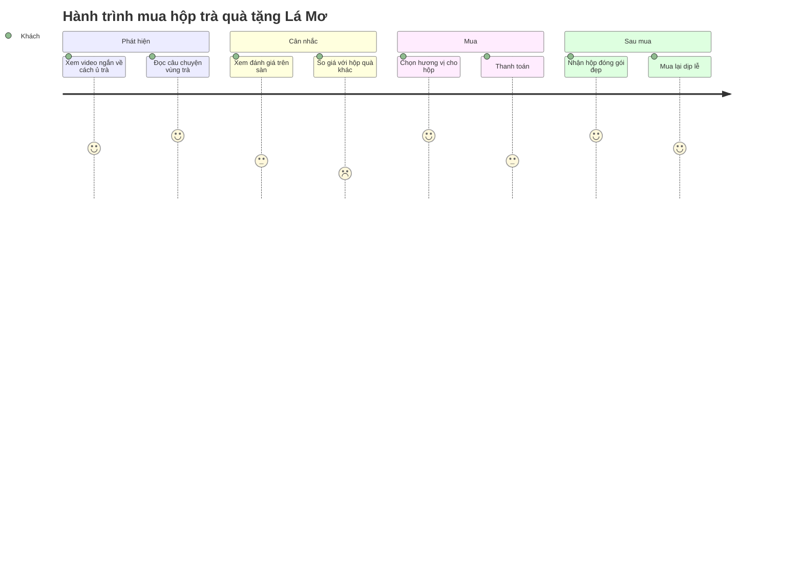
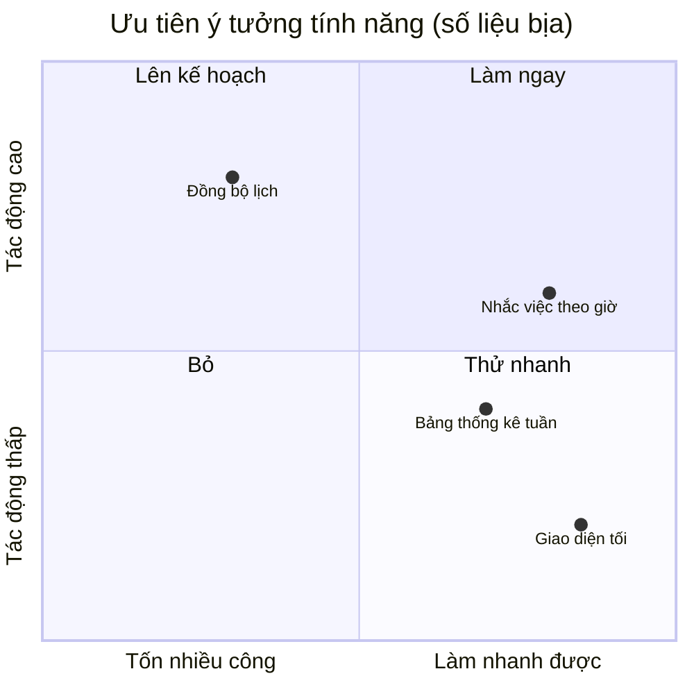
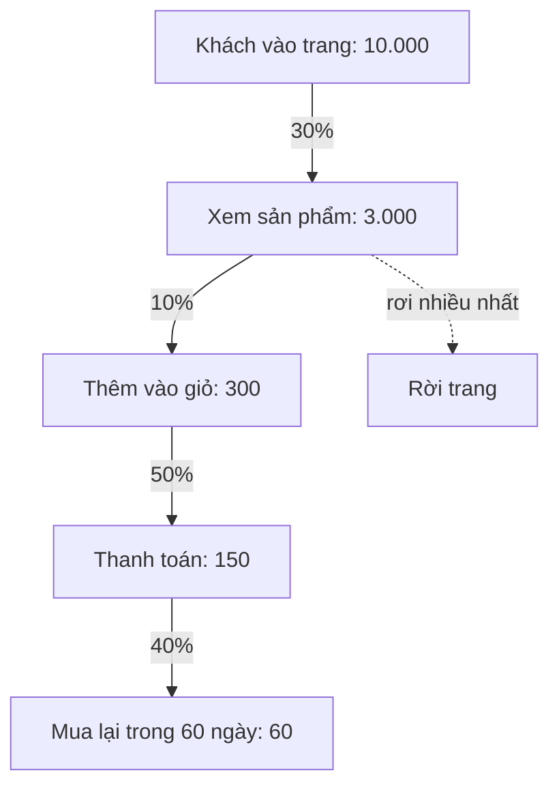
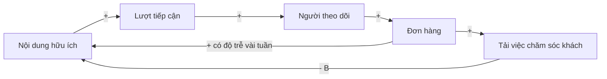
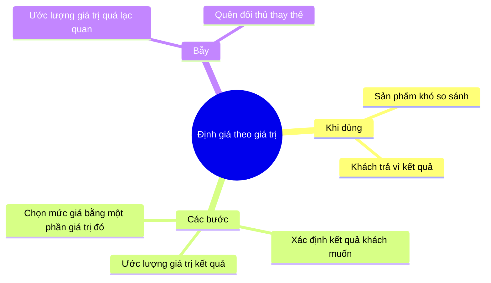
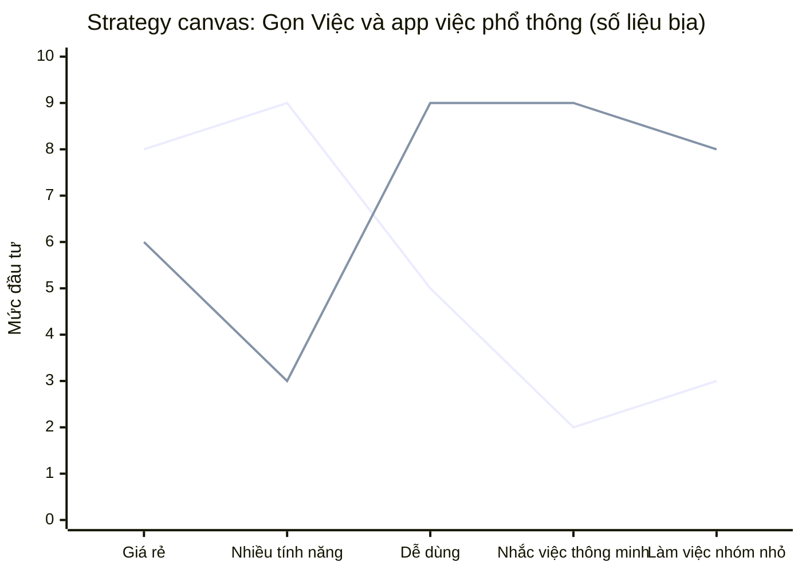
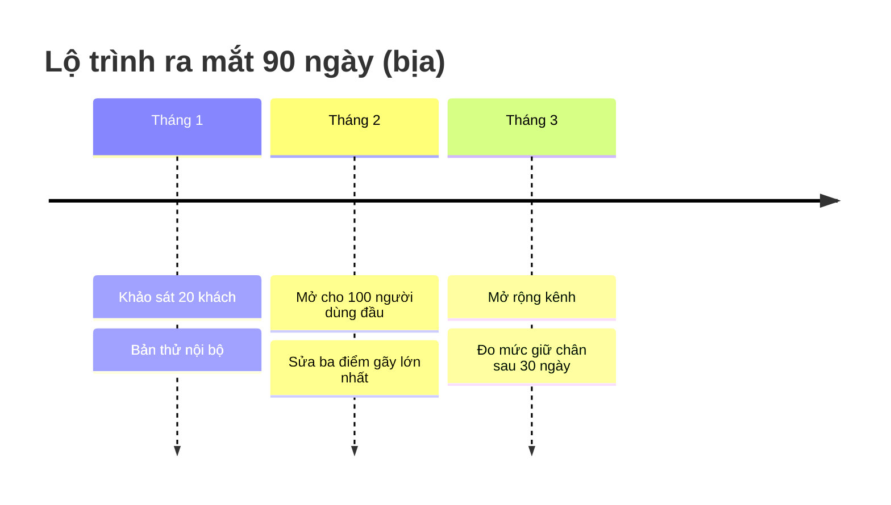

# Mermaid cookbook

Các khối Mermaid hay dùng cho sơ đồ tư duy. Mọi ví dụ dùng thương hiệu và số liệu bịa (cửa hàng trà "Lá Mơ", app "Gọn Việc", ...). Chép khối, thay nội dung bằng dữ liệu thật của người dùng, đặt trong khối mã đánh dấu `mermaid`.

Nếu không chắc nơi xem có vẽ được Mermaid, đưa kèm bảng chữ cùng nội dung, hoặc chuyển sang trang HTML (xem `html-chart-canvas.md`).

## 1. Journey map (`journey`)

Số 1 đến 5 là mức hài lòng tại điểm chạm. Điểm 1 và 2 là chỗ cần sửa trước.

## 2. Ma trận 2x2 và bản đồ định vị (`quadrantChart`)

Tọa độ điểm từ 0 đến 1. Đặt tên góc bằng hành động. Quy ước: góc 1 là trên phải, 2 trên trái, 3 dưới trái, 4 dưới phải.

Bản đồ định vị dùng cùng khối: hai trục là hai tiêu chí khách quan tâm (ví dụ "giá" và "mức cá nhân hóa"), mỗi điểm là một thương hiệu; vùng trống là cơ hội cần kiểm chứng.

## 3. Phễu và quy trình (`flowchart`)

Ghi số và tỷ lệ giữ lại trên mũi tên. Số dưới đây là bịa.

## 4. Vòng phản hồi (`flowchart`)

Dấu cộng nghĩa là hai biến cùng chiều, dấu trừ là ngược chiều. Gắn nhãn vòng R (tăng cường) hoặc B (cân bằng) và ghi chỗ có độ trễ.

Đọc: vòng ngoài là R (nội dung sinh đơn, đơn nuôi lại nội dung); nhánh qua tải chăm sóc là B (kìm lại khi nhóm quá tải). Đòn bẩy thường nằm ở nhánh B.

## 5. Mindmap một framework (`mindmap`)

## 6. Strategy canvas (`xychart-beta`)

`xychart-beta` còn thử nghiệm, đường có thể thô và không phải nơi nào cũng hỗ trợ. Cần bản đẹp hoặc nhãn trực tiếp trên đường thì dùng trang HTML. Mỗi `line` là một đường, theo thứ tự đã nêu trong chú thích.

Đường 1 là app phổ thông, đường 2 là Gọn Việc. Hai đường tách xa ở "nhắc việc thông minh" và "làm việc nhóm nhỏ": đó là vùng khác biệt cần kiểm chứng với khách thật.

## 7. Timeline (`timeline`)

## Mẹo cú pháp

- Dòng đầu là loại sơ đồ (`journey`, `quadrantChart`, `flowchart LR`, ...). Thiếu dòng này thì không vẽ.
- Nhãn có dấu tiếng Việt thường vẽ được. Khối nào vỡ: bọc nhãn trong dấu ngoặc kép, hoặc bỏ ký tự đặc biệt như dấu hai chấm, ngoặc, dấu chấm phẩy trong nhãn.
- Trong `flowchart`, nhãn có dấu cách và ký tự đặc biệt nên đặt trong ngoặc vuông; mã nút (A, B, ...) viết liền, không dấu.
- Giữ dưới khoảng 12 nút mỗi sơ đồ; nhiều hơn thì tách.
